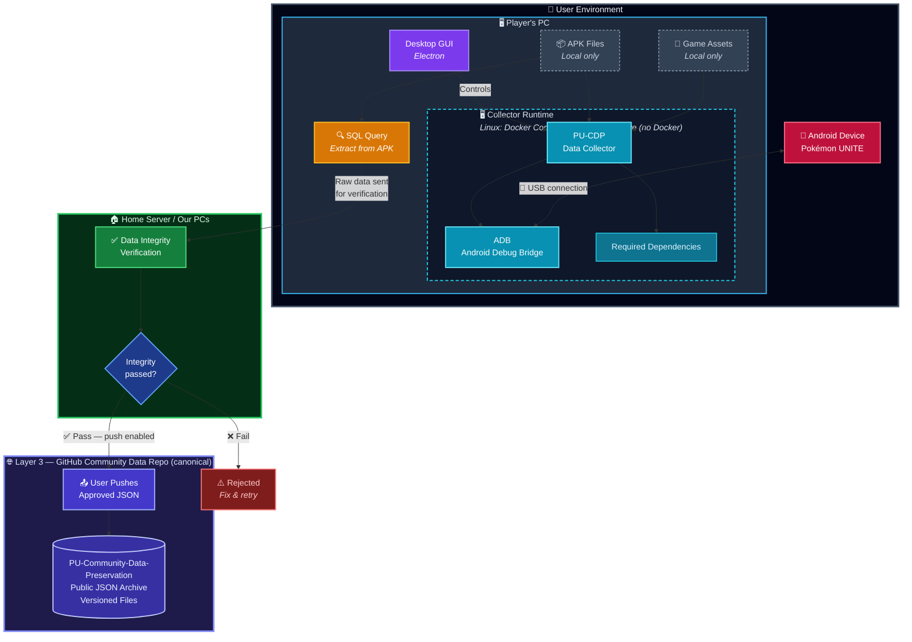

# Pokémon UNITE Community Data Preservation

An open-source, community-driven initiative to preserve Pokémon UNITE's game data, player progress, and history.

## Purpose

Pokémon UNITE is approaching its shutdown. This project aims to help the community preserve as much of the game and its history as possible through collaborative data collection and documentation.

The initiative is independent of Revival Games and is intended to complement its server development efforts.

This project is not affiliated with Nintendo, The Pokémon Company, Tencent, or TiMi Studio Group.

## Core Principles

- **Open source:** Transparent tools and workflows that the community can inspect and contribute to.
- **Community-driven:** Players, developers, and competitive communities can participate.
- **Privacy first:** Contributors decide whether to share their collected data.
- **Reproducibility:** A standardized environment makes data collection consistent and accessible.
- **Data integrity:** Contributions should be validated before entering the shared archive.

## Project Scope

- Back up as many game files as possible (APK)
- Back up assets (if users agree)
- Back up player data
- Create a global database of contributors to help data migration

The exact collection scope and data schema remain open for discussion.

## Contribution Workflow

The proposed workflow is:

1. The contributor connects their phone to the PC.
2. The tools collect and organize the available data through the ADB tool.
3. A contribution package is generated.
4. The contributor reviews the information through a GUI.
5. The contributor explicitly approves or rejects the submission.
6. Approved contributions are sent to the backend (literal humans).
7. The backend validates and processes the data before adding it to the **GitHub archive**, which is the canonical public record.

Users should never need direct database access or be required to edit or execute SQL statements.

**Preferred payload format: JSON.** Contribution packages are structured JSON, not SQL, and clients must not generate SQL. The backend owns every database write and applies it only after validation. The exact JSON schema, Pydantic models, and archive layout are still under discussion.

**SQL fallback — under investigation.** A concrete case may emerge where some data cannot be expressed or validated in JSON alone (for example, when reproducing a schema-critical subset that the backend needs to verify row-by-row). If such a case is confirmed, the exception will be documented here, scoped narrowly, and reviewed before it ships. It will not be introduced silently.

## Data Storage

**Canonical archive: GitHub.** All approved contribution packages are committed to this repository as versioned JSON files. This is the public, auditable record of preserved data and the only source of truth. If any derived service is lost, the archive alone is sufficient to reconstruct it.

**Community database (planned, derived).** A queryable community database may be built as an **index over the GitHub archive**, to make lookups practical for data migration and analysis. It is **not** the source of truth and can be dropped and rebuilt at any time from the archive. The database technology (SQLite, Postgres, or other) remains undecided and depends on access patterns still under discussion.

Collection tools and the APK remain on the contributor's local device. APKs and proprietary game assets should not be uploaded to this public repository.

## Privacy and Security

This tool **won't upload anything by default.** It is primarily meant to decentralize game preservation and provide as many fallback options as possible.

If you choose to, the only data uploaded is information about your profile. This helps build a database of players if data migration is implemented in the Revival project. The data uploaded is the structured JSON package describing your profile; no other data leaves your PC. The backend converts that package into database writes server-side — clients never submit SQL.

- Participation and data submission must be voluntary.
- Contributors should only submit data they own or are authorized to share.
- We do not collect passwords, authentication tokens, session cookies, or other credentials.
- Avoid exposing personal information belonging to other players.
- Contributions must be reviewed before submission.
- The backend must validate incoming data.
- Collection methods must be reviewed to avoid unnecessary security or platform risks.

### Discord as a validation method for database migration

A Discord-based validation step is planned **only when a contribution moves from the GitHub archive into the shared community database** — that is, to reduce spam and dirty data in the queryable index by requiring contributors to prove they are real members of the community.

It is **not** required to build a local backup and it is **not** required to submit a package to the GitHub archive. The exact mechanism (server membership check, OAuth scope, what is retained after verification) remains under discussion.

## Platform Support

Windows and Linux are the supported platforms. They differ in how the collector runs, because Android USB access is unreliable from containers on Windows:

- **Windows — native, no Docker.** The desktop app and ADB run directly on the host. Distribution target: one-click installer. Docker Desktop/WSL2 cannot reliably pass an Android device through, so the Windows build must not depend on a container.
- **Linux — Docker Compose.** The collector runs in a Docker Compose stack with the phone mapped in (`/dev/bus/usb`) and udev permissions configured.

The dev container remains the standard _development_ environment on both platforms; the split above applies to how end users collect data.

## Development Environment

Development is standardized with Docker and VS Code Dev Containers, so Windows and Linux contributors share one toolchain: Python, Node, Electron, Xvfb + noVNC, and Patchright. Android emulator support is planned.

Because USB/ADB code must work both natively (Windows) and inside a container (Linux), do not assume either environment when touching device access.

Setup, app launch, and pre-PR checks live in [CONTRIBUTING.md](CONTRIBUTING.md).

### Architecture Overview



> The diagram is illustrative. It shows a possible flow where the APK is queried locally and raw data is sent for verification; the final payload format (JSON, with a scoped SQL fallback under investigation) and the exact transport will be reflected here once the design is locked.

### User Story

```
As a Pokémon UNITE player, I want a one-click installer for Windows that sets everything up automatically, with minimal user involvement. I should only need to enable Developer Mode on my Android device and connect it via USB.

On Linux, I want a single install command for the Docker-based collector, with the same minimal setup and no manual USB configuration.

To log in, I should use my Discord account and be a member of the Pokémon UNITE Revival server.

The application should have a very simple interface with just a few buttons. The main one should be Start Process. Once clicked, I can watch the program create a complete backup of my account data in the application's folder.

When the backup is complete, the app should ask whether I want to validate my data and submit it to the community repository.

Finally, I should receive a Discord DM confirming that the process was successful, along with a link to my file in the repository.
```

## How to Contribute

Contributions are welcome. See [CONTRIBUTING.md](CONTRIBUTING.md) for the development setup, ground rules, where help is needed, and the pull-request checklist.

## Open Questions

The following items still need community discussion. Items marked ✅ are resolved; 🔄 are in progress with a direction chosen but details open; ❓ remain fully open.

# Open Questions (English)

For each data category, four independent questions must be answered before the category can be scoped:

- **Does it exist locally?** If it only lives on TiMi's servers, we cannot capture it.

- **Where does it live locally?** Path, file, format — this determines the `adb pull` command.

- **Can we access it?** Root, emulator, Shizuku, or Charles's modified client.

- **Should we preserve it?** Community value vs. privacy risk vs. legal risk.

- ✅ **Canonical archive vs. database:** GitHub is the canonical public archive. Any community database is a derived, rebuildable index over it.
- ✅ **Platforms:** Windows runs natively without Docker (USB mapping into Docker Desktop/WSL2 is unreliable); Linux runs the collector in Docker Compose with USB device passthrough.
- 🔄 **Payload format:** JSON is preferred; clients must not generate SQL. A scoped SQL fallback is under investigation for cases where JSON alone cannot carry data the backend must validate. Details open.
- 🔄 **Discord role:** Discord is planned as a validation method **only for database migration**, not for base submission to the GitHub archive. Mechanism and retention policy open.
- ❓ Which data should be prioritized?
- ❓ What collection methods should be supported?
- ❓ What should the contribution data schema look like? (A preliminary field set exists — `game_version`, `collected_at`, `tool_version`, `consent` — but the full schema is open.)
- ❓ How should the community database be protected from spam, duplicates, and version spoofing beyond the Discord migration gate?
- ❓ How should player data be anonymized and protected?
- ❓ How should game versions and historical changes be tracked? (Central to a preservation project; not a nice-to-have.)
- ❓ What is the withdrawal/deletion policy for an already-published contribution?
- ❓ What is the legal posture for APK extraction and game-asset backup beyond the trademark disclaimer?

## Relationship with Revival Games

This initiative is separate from Revival Games' server development.

Its purpose is to organize community data preservation and provide useful documentation and tools that may support future preservation efforts.

## Disclaimer

This is an independent community project. Pokémon UNITE and all associated intellectual property belong to their respective owners.

## Closing

**Preserving the game, its history, and the community that made it special.**
