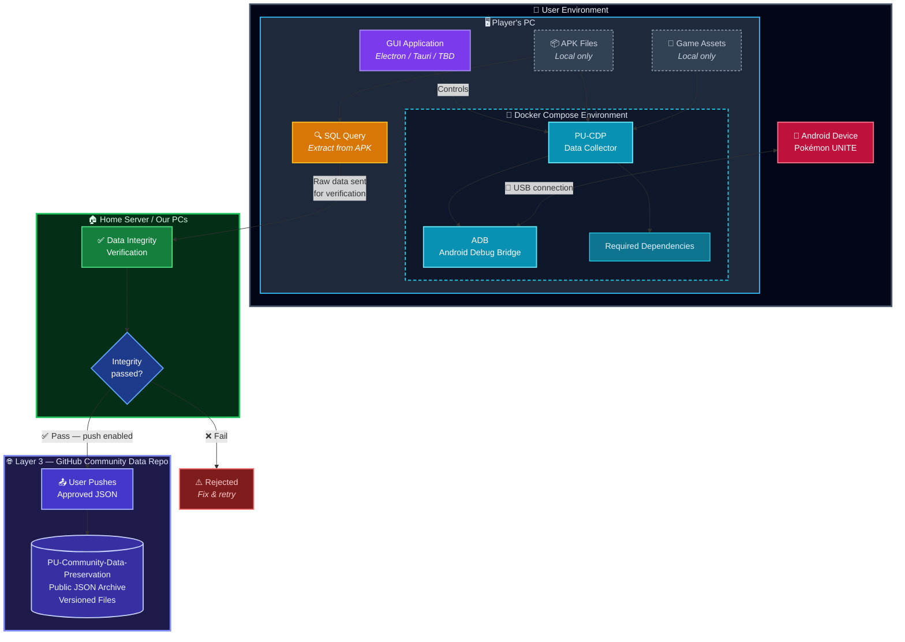

# Pokémon UNITE Community Data Preservation

An open-source, community-driven initiative to preserve Pokémon UNITE's game data, player progress, and history.

## Purpose

Pokémon UNITE is approaching its shutdown. This project aims to help the community preserve as much of the game and its history as possible through collaborative data collection and documentation.

The initiative is independent of Revival Games and is intended to complement its server development efforts.

This project is not affiliated with Nintendo, The Pokémon Company, Tencent, or TiMi Studio Group.

## Core Principles

- **Open source:** Transparent tools and workflows that the community can inspect and contribute to.
- **Community-driven:** Players, developers, and competitive communities can participate.
- **Privacy first:** Contributors decide whether to share their collected data.
- **Reproducibility:** A standardized environment makes data collection consistent and accessible.
- **Data integrity:** Contributions should be validated before entering the shared database.

## Project Scope

- Back up as many game files as possible (APK)
- Back up assets (if users agree)
- Back up player datas
- Create a global database of contributors to help data migration
The exact collection scope and data schema remain open for discussion.

## Contribution Workflow

The proposed workflow is:

1. The contributor connects its phone to the pc
2. The tools collect and organize the available data thought the ADB tool.
3. A contribution package is generated.
4. The contributor reviews the information through a GUI.
5. The contributor explicitly approves or rejects the submission.
6. Approved contributions are sent to the backend. (<- litteral humans)
7. The backend validates and processes the data before adding it to the shared database.

Users should never need direct database access or be required to edit or execute SQL statements.

**Preferred approach:** use structured contribution data, such as JSON, rather than executable SQL generated on the client. The backend should handle database operations.

## Data Storage

The current proposal includes a shared community database.

SQLite has been suggested as a possible solution, but the final database technology has not yet been decided.

The collection tools and APK remain on the contributor's local device. APKs and proprietary game assets should not be uploaded to this public repository.

## Privacy and Security

This tool **won't upload anything by default.** It is primarily meant to decentralize the game preservation and have as much fallback options as possible.

If you choose to, the only data uploaded are informations about your profile. This will help create a database of players if data migration is implemented in the Revival project.
The data uploaded is only the SQL query used to populate the database with your profile, no other data leaves your PC.

- Participation and data submission must be voluntary.
- Contributors should only submit data they own or are authorized to share.
- We do not collect passwords, authentication tokens, session cookies, or other credentials.
- Avoid exposing personal information belonging to other players.
- Contributions must be reviewed before submission.
- The backend must validate incoming data.
- Collection methods must be reviewed to avoid unnecessary security or platform risks.

## Development Environment

We aim to provide a standardized, reproducible development environment using:

- Docker and Docker Compose.
- VS Code Dev Containers.
- Recommended VS Code extensions.
- Android emulator support.
- Setup scripts and beginner-friendly documentation.

The goal is to make participation accessible to developers with different levels of experience.

### Architecture Overview



### User Story

```
As a Pokémon UNITE player, I want a one-click installer for Windows that sets everything up automatically, with minimal user involvement. I should only need to enable Developer Mode on my Android device and connect it via USB.

To log in, I should use my Discord account and be a member of the Pokémon UNITE Revival server.

The application should have a very simple interface with just a few buttons. The main one should be Start Process. Once clicked, I can watch the program create a complete backup of my account data in the application's folder.

When the backup is complete, the app should ask whether I want to validate my data and submit it to the community repository.

Finally, I should receive a Discord DM confirming that the process was successful, along with a link to my file in the repository.
```

## How to Contribute

Contributions are welcome in areas such as:

- Data collection and validation.
- Android development and emulator setup.
- Unity research and game data analysis.
- Database schema and backend development.
- GUI and developer tooling.
- Documentation and tutorials.
- Competitive gameplay knowledge and data verification.

## Open Questions

The following decisions still need community discussion:

- Which data should be prioritized?
- What collection methods should be supported?
- What should the contribution data schema look like?
- Which database technology should we use?
- How should player data be anonymized and protected?
- How should game versions and historical changes be tracked?

## Relationship with Revival Games

This initiative is separate from Revival Games' server development.

Its purpose is to organize community data preservation and provide useful documentation and tools that may support future preservation efforts.

## Disclaimer

This is an independent community project. Pokémon UNITE and all associated intellectual property belong to their respective owners.

## Closing

**Preserving the game, its history, and the community that made it special.**
